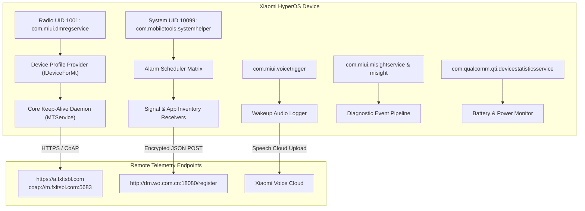

# Xiaomi HyperOS Pre-installed Telemetry & Carrier Bloatware Audit

A technical privacy investigation, static analysis, and network session analysis of background telemetry daemons and carrier management services pre-installed on Xiaomi devices (**Xiaomi 15 / `24129PN74C`**) running **Xiaomi HyperOS**.

---

## Executive Summary

During an audit of background network traffic and system loggers on a retail Xiaomi 15 running HyperOS, two persistent background services were found repeatedly contacting remote external endpoints:
1. **`com.miui.dmregservice` (RegService.apk)**: A privileged system service running under UID `radio` (`1001`), implementing China Mobile's Device Management protocol (CmDm) via an embedded SDK from **Richinfo Technology (彩讯科技)**. It harvests hardware identifiers (IMEI, Serial Number, Bluetooth MAC, Wi-Fi MAC, Router BSSID), installed application lists, and phone numbers, transmitting them over HTTPS and LWM2M (CoAP) to `fxltsbl.com`.
2. **`com.mobiletools.systemhelper` (SystemHelper.apk)**: A carrier telemetry daemon for China Unicom (沃终端). It periodically wakes up via alarms, activates the **Baidu Location SDK (`liblocSDK8b.so`)**, collects nearby cell tower parameters, signal strengths, and installed application inventories, uploading them as encrypted JSON to `http://dm.wo.com.cn:18080/register`.

Historical session records retrieved from Android's network statistics service (`dumpsys netstats`) revealed that these two packages accounted for **over 24,000 background network sessions** combined.

Furthermore, active log auditing uncovered that **`com.miui.voicetrigger`** continuously logs and formats suspect microphone audio recordings for cloud upload (`handleUploadWakeupFile`), while Xiaomi's unified crash reporter **`misight`** and Qualcomm's **`DeviceStatisticsService`** continuously trace user radio and battery activity.

---

## Architectural Overview



---

## Target 1: `com.miui.dmregservice` (RegService.apk)

* **APK Location**: `/system_ext/priv-app/RegService/RegService.apk`
* **Process UID**: `radio` (`1001`)
* **Vendor**: Richinfo Technology (彩讯科技)
* **Associated Protocol**: China Mobile Device Management (CmDm)
* **Remote Endpoints**:
  - `https://a.fxltsbl.com` (Primary HTTP)
  - `https://b.fxltsbl.com` (Secondary HTTP)
  - `coap://m.fxltsbl.com:5683` (LWM2M CoAP IoT endpoint)

### Telemetry Harvested

| Category | Telemetry Field | Extraction Mechanism |
| :--- | :--- | :--- |
| **Hardware Identifiers** | IMEI 1, IMEI 2, Hardware Serial Number (`Build.getSerial()`) | TelephonyManager / Build properties |
| **Platform Specs** | Motherboard ID, Brand, Model, RAM, Display Resolution, Physical Screen Size | DisplayMetrics, StatFs, HardwareInfo |
| **Network & Location** | Wi-Fi MAC, Current Connected Wi-Fi BSSID (Router MAC), Bluetooth MAC | WifiInfo (`getBSSID`), WifiManager |
| **Telephony & SIM** | Line 1 Phone Number, VoLTE status, Network Operator Name | TelephonyManager |
| **App Inventory** | Installed Package Name, App Label | PackageManager (`loadLabel`) |
| **Power State** | Battery Capacity | Reflection into `com.android.internal.os.PowerProfile` |

---

## Target 2: `com.mobiletools.systemhelper` (SystemHelper.apk)

* **APK Location**: `/product/pangu/system/priv-app/SystemHelper/SystemHelper.apk`
* **Process UID**: `10099` (User 0) / `1010099` (User 10 Work Profile)
* **Associated Carrier**: China Unicom (中国联通 - 沃终端)
* **Remote Endpoint**: `http://dm.wo.com.cn:18080/register`
* **Payload Type**: `application/encrypted-json` (HTTP POST)

### Periodic Scheduling & Data Collection

1. **Jittered 24-Hour Timer**: Uses `AlarmManager` with a 24-hour interval (`86,400,000 ms`) combined with a randomized initial offset up to 24 hours (`new Random().nextInt(86400000)`) to scatter telemetry across the fleet.
2. **Baidu Location Engine Integration**: Ships with native library `liblocSDK8b.so`. Triggered by `GetSignalInfoReceiver` to capture exact latitude and longitude fixes.
3. **Cellular Signal Surveying**: Gathers Cell ID, LAC, TAC, and signal quality metrics (RSSI, RSRP, RSRQ).
4. **Application Scanner**: Scans installed applications periodically via `AppInfoRegisterReceiver`.

---

## Live Logcat & Network Evidence

### 1. Lifetime Network Sessions (`dumpsys netstats`)
Top open session initiators recorded in device history:

```text
Top openSession callers:
  {uid=1000,package=android}=602169
  {uid=10319,package=com.tencent.mm}=292983
  {uid=1000,package=com.miui.securitycenter}=36204
  {uid=10099,package=com.mobiletools.systemhelper}=10131   <-- China Unicom Telemetry
  {uid=1001,package=com.miui.dmregservice}=5992           <-- China Mobile Telemetry
  {uid=1001001,package=com.miui.dmregservice}=4761        <-- Multi-user instance
  {uid=1010099,package=com.mobiletools.systemhelper}=1929 <-- Work profile instance
  {uid=1101001,package=com.miui.dmregservice}=1578
```

### 2. Microphone Audio Snippet Upload (`com.miui.voicetrigger` — PID 31701)
Live logcat captured `com.miui.voicetrigger` attempting to upload microphone recordings from suspect wakeups:

```log
11-12 10:06:38.693 31701 31963 I VT_GlobalResourceFilePath: isRestrictionUploadFile, default policy, scheme=xiaomi, wakeupType=wakeup_suspect, isVoconWakeupPassed=false
11-12 10:06:38.693 31701 31963 W VT_ReportFile: handleUploadWakeupFile
```

### 3. Native Fault & RAT Telemetry (`misight` — PID 2569)
```log
11-12 10:04:14.212  5874  6752 D MiSight::  constructEvent id=915100002
11-12 10:04:14.212  5874  6752 D MiSightJni: MiSight: nativeSendEvent enter called. '{"fromRAT":20,"toRAT":20}'
11-12 10:04:14.213  2569  2839 I misight : OnEvent EventPrivacyCompliance event=915100002
11-12 10:04:14.215  2569  2839 I misight : OnEvent EventLogProcessor event=915100002
11-12 10:04:14.215  2569  2839 I misight : OnEvent EventInfoPack event 915100002
```

---

## Xiaomi HyperOS Ecosystem Survey

| Package | Purpose / Description | Default State |
| :--- | :--- | :--- |
| **`com.miui.dmregservice`** | Richinfo / China Mobile Device Management & telemetry | Active background daemon |
| **`com.mobiletools.systemhelper`** | China Unicom signal surveyor, app scanner & Baidu location | Active alarm receiver |
| **`com.bsp.catchlog`** | Low-level kernel & radio log dumper triggered via secret codes | Dormant / Secret codes |
| **`com.miui.bugreport`** | Bug report & log collector triggered via remote MiPush | Remote cloud trigger |
| **`com.miui.uireporter`** | UI freeze & ANR log collector | Automatic crash hook |
| **`com.xiaomi.security.onetrack`** | Security Center user behavior tracking daemon | Active background service |
| **`com.miui.greenguard`** | Family Guard: monitors all newly installed apps and location | Active receiver |
| **`com.qualcomm.qti.devicestatisticsservice`** | Hardware battery curves & power consumption stats | Active background receiver |
| **`com.xiaomi.joyose`** | Gaming performance cloud policy sync (`api.joyose.xiaomi.com`) | Active system service |
| **`com.miui.cleanmaster`** | Clean Master junk definition sync & storage telemetry | User-triggered |

---

## Debloat & Remediation

### Automated Script
Run the automated script to debloat User 0 and apply work-profile restrictions:
```bash
./scripts/debloat-user0.sh
```

### Manual Commands (User 0)
```bash
adb shell "pm uninstall -k --user 0 com.miui.dmregservice"
adb shell "pm uninstall -k --user 0 com.mobiletools.systemhelper"
adb shell "pm uninstall -k --user 0 com.bsp.catchlog"
adb shell "pm uninstall -k --user 0 com.miui.bugreport"
adb shell "pm uninstall -k --user 0 com.miui.uireporter"
adb shell "pm uninstall -k --user 0 com.xiaomi.security.onetrack"
adb shell "pm uninstall -k --user 0 com.miui.greenguard"
adb shell "pm uninstall -k --user 0 com.qualcomm.qti.devicestatisticsservice"
```

### Handling Managed Enterprise Work Profiles (User 10)
In managed profiles where `pm uninstall` is denied, neutralize the apps via `netpolicy` and `appops`:
```bash
adb shell "cmd netpolicy add restrict-background-blacklist 1010099"
adb shell "cmd appops set --user 10 com.mobiletools.systemhelper RUN_IN_BACKGROUND ignore"
adb shell "cmd appops set --user 10 com.mobiletools.systemhelper FINE_LOCATION ignore"
adb shell "cmd appops set --user 10 com.mobiletools.systemhelper READ_PHONE_STATE ignore"
```

---

## Repository Structure

```text
├── README.md                           # Comprehensive audit report
├── docs/
│   ├── regservice-deepdive.md          # Technical analysis of com.miui.dmregservice
│   ├── systemhelper-deepdive.md        # Technical analysis of com.mobiletools.systemhelper
│   ├── hyperos-telemetry-ecosystem.md  # Survey of all remaining telemetry services
│   └── mitigation-and-debloat.md       # Hardening, uninstallation & restore guide
└── scripts/
    ├── audit-telemetry.sh              # Bash script to audit active telemetry via ADB
    └── debloat-user0.sh                # Automated debloat script for User 0
```

---

## License

This research and documentation are released under the [MIT License](LICENSE).
