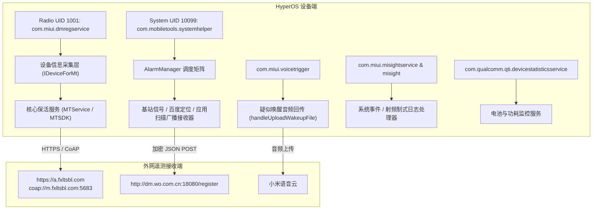

# 小米 HyperOS 预装遥测与运营商内置服务审计报告

[English](README.md) | [简体中文](README_zh.md)

针对小米设备（**Xiaomi 15 / `24129PN74C`**）搭载的 **Xiaomi HyperOS** 系统，对后台隐蔽运行的遥测常驻守护进程、运营商设备管理（DM）服务及日志回传组件进行的逆向静态分析、网络会话审计与现场日志追踪报告。

---

## 执行概要

在对搭载 HyperOS 的量产版小米 15 进行后台网络活动与系统日志审计时，发现两个随系统底层常驻的特权组件存在高频向外网第三方服务器回传设备与隐私数据的行为：

1. **`com.miui.dmregservice`（RegService.apk）**：
   伪装为系统级电话特权进程（运行于 `radio` / UID `1001`），实为**中国移动终端管理（CmDm）**客户端，内嵌**彩讯科技（Richinfo）**的 MTSDK。该组件会持续读取设备的双 IMEI、硬件序列号、蓝牙 MAC、Wi-Fi MAC、**当前连接的 Wi-Fi 路由器 BSSID（可用于物理精确定位）**、手机号、已安装应用列表，并通过反射读取电池容量等硬件信息，经 HTTPS 与 LWM2M（CoAP）协议上传至 `fxltsbl.com`。
2. **`com.mobiletools.systemhelper`（SystemHelper.apk）**：
   **中国联通终端管理（沃终端）**的后台采集组件。通过底层的 Alarm 闹钟矩阵定时唤醒，动态加载**百度定位 SDK（`liblocSDK8b.so`）**采集精确 GPS 经纬度，配合扫描周边基站小区编号（Cell ID、LAC、TAC）与信号质量参数，并遍历全机已安装应用列表，打包成加密 JSON 通过 HTTP POST 上传至 `http://dm.wo.com.cn:18080/register`。

根据 Android 底层网络统计模块（`dumpsys netstats`）的历史累计记录，仅这两个组件在设备生命周期中就发起了**超过 24,000 次后台网络会话**。

此外，现场日志跟踪进一步证实：**`com.miui.voicetrigger`（小爱语音唤醒）** 会持续将疑似唤醒的麦克风录音切片格式化并尝试上传云端（`handleUploadWakeupFile`），而小米统一故障诊断进程 **`misight`** 和高通 **`DeviceStatisticsService`** 则在后台高频记录基站网络制式切换与电池硬件数据。

---

## 架构概览



---

## 核心分析对象 1：`com.miui.dmregservice` (RegService.apk)

* **安装路径**：`/system_ext/priv-app/RegService/RegService.apk`
* **运行 UID**：`radio` (`1001`)
* **方案供应商**：彩讯科技（Richinfo Technology）
* **所属运营商业务**：中国移动终端管理（CmDm）
* **回传服务器端点**：
  - `https://a.fxltsbl.com`（默认 HTTP 接口）
  - `https://b.fxltsbl.com`（备用 HTTP 接口）
  - `coap://m.fxltsbl.com:5683`（轻量级物联网 LWM2M 协议接口）

### 采集的隐私与设备数据项

| 类别 | 采集字段与方法 | 说明与隐私隐患 |
| :--- | :--- | :--- |
| **硬件唯一标识** | IMEI 1、IMEI 2、硬件序列号（`Build.getSerial()`） | 跨应用绑定的不可篡改设备指纹 |
| **设备基础参数** | 主板型号、厂商、型号、运行内存、屏幕物理尺寸、分辨率 | 详细软硬件配置档案 |
| **网络与精确定位** | 本机 Wi-Fi MAC、**当前连接的路由器 BSSID**、蓝牙 MAC | **路由器 BSSID 结合公网库可直接解算出家庭/办公室内具体坐标** |
| **SIM 与运营商** | 卡 1 手机号码、网络运营商代号、VoLTE 开启状态 | 绑定用户真实手机号与通信状态 |
| **已安装应用** | 应用名称、包名列表（`loadLabel` / `packageName`） | 暴露用户全部安装软件画像 |
| **硬件运行状态** | 通过 Java 反射访问 `com.android.internal.os.PowerProfile` | 逆向读取系统隐藏的电池额定容量与状态 |

### 进程保活与唤醒机制
该应用内部注册了名为 `MTService` 的后台服务，代码中明文将其标记为 **`核心保活服务`**，利用 `JobScheduler` 和 Alarm 闹钟保证自身随系统启动并无限循环拉起，在本地 SharedPreferences 中记录首次激活时间与回传周期。

---

## 核心分析对象 2：`com.mobiletools.systemhelper` (SystemHelper.apk)

* **安装路径**：`/product/pangu/system/priv-app/SystemHelper/SystemHelper.apk`
* **运行 UID**：`10099`（主用户 User 0）/ `1010099`（工作空间 User 10）
* **所属运营商业务**：中国联通终端管理（沃终端）
* **回传服务器端点**：`http://dm.wo.com.cn:18080/register`
* **报文协议**：HTTP POST，请求头标注 `Content-Type: application/encrypted-json`

### 周期性采集机制与行为特征

1. **24 小时随机抖动算法**：
   在调度逻辑中使用 `new Random().nextInt(86400000)` 生成最多 24 小时（86400 秒）的随机偏移量，将全量回传流量分散在全天各个时段，以避开集中抓包与服务器并发峰值。
2. **内嵌百度定位 SDK（`liblocSDK8b.so`）**：
   由 `GetSignalInfoReceiver` 周期性触发，调用百度定位底层 SO 库获取 GPS 经纬度信息。
3. **基站无线参数勘测**：
   持续读取手机所连接的基站代码（Cell ID）、位置区码（LAC）、跟踪区码（TAC）以及 4G/5G 频段的信号接收强度（RSSI、RSRP、RSRQ）。
4. **全机应用定期清点**：
   通过 `AppInfoRegisterReceiver` 扫描系统内已安装的所有第三方与系统级应用包名及版本。

---

## 现场抓包与系统日志证据

### 1. 网络连接次数历史统计（`dumpsys netstats`）
查看 Android 系统底层记录的网络会话累计次数，这两个应用高居非用户交互类后台服务榜首：

```text
Top openSession callers:
  {uid=1000,package=android}=602169
  {uid=10319,package=com.tencent.mm}=292983
  {uid=1000,package=com.miui.securitycenter}=36204
  {uid=10099,package=com.mobiletools.systemhelper}=10131   <-- 联通系统助手
  {uid=1001,package=com.miui.dmregservice}=5992           <-- 移动设备管理
  {uid=1001001,package=com.miui.dmregservice}=4761        <-- 多用户分身实例
  {uid=1010099,package=com.mobiletools.systemhelper}=1929 <-- 工作空间实例
  {uid=1101001,package=com.miui.dmregservice}=1578
```

### 2. 小爱语音唤醒音频切片回传日志（`com.miui.voicetrigger` — PID 31701）
Logcat 记录到小爱唤醒模块对麦克风侦听到的疑似误唤醒音频进行打包并准备回传云端：

```log
11-12 10:06:38.693 31701 31963 I VT_GlobalResourceFilePath: isRestrictionUploadFile, default policy, scheme=xiaomi, wakeupType=wakeup_suspect, isVoconWakeupPassed=false
11-12 10:06:38.693 31701 31963 W VT_ReportFile: handleUploadWakeupFile
```

### 3. HyperOS 原生崩溃与射频切换遥测（`misight` — PID 2569）
原生 C++ 守护进程 `misight` 持续捕获设备基站网络制式转换与事件包打包：

```log
11-12 10:04:14.212  5874  6752 D MiSight::  constructEvent id=915100002
11-12 10:04:14.212  5874  6752 D MiSightJni: MiSight: nativeSendEvent enter called. '{"fromRAT":20,"toRAT":20}'
11-12 10:04:14.213  2569  2839 I misight : OnEvent EventPrivacyCompliance event=915100002
11-12 10:04:14.215  2569  2839 I misight : OnEvent EventLogProcessor event=915100002
11-12 10:04:14.215  2569  2839 I misight : OnEvent EventInfoPack event 915100002
```

---

## HyperOS 系统内置遥测与日志抓取组件总览

| 包名 | 组件名称与功能说明 | 默认运行状态 |
| :--- | :--- | :--- |
| **`com.miui.dmregservice`** | 中国移动设备管理 / 彩讯科技后台数据回传 | 后台常驻守护进程 |
| **`com.mobiletools.systemhelper`** | 中国联通基站信号采集、已装软件清点与百度定位 | 定时 Alarm 广播常驻 |
| **`com.bsp.catchlog`** | BSP 底层日志抓取（响应拨号盘暗码 `SECRET_CODE` 抓取 Modem / 内核日志） | 监听系统暗码 |
| **`com.miui.bugreport`** | MIUI 错误报告回传（监听小米推送 MiPush 远程指令静默打包上传） | 响应云端推送唤醒 |
| **`com.miui.uireporter`** | 界面异常与 ANR 卡顿日志捕获 | 发生卡顿时自动触发 |
| **`com.xiaomi.security.onetrack`** | 小米手机管家 / 安全中心内部埋点分析服务 | 开机自动启动 (`BOOT_COMPLETED`) |
| **`com.miui.greenguard`** | 风筝守护：监听新装应用通知（`DOWNLOAD_INSTALL_RESULT`）与定位 | 监听应用安装与网络状态 |
| **`com.qualcomm.qti.devicestatisticsservice`** | 高通硬件统计服务：持续统计电池充放电曲线与硬件能耗 | 后台常驻监听系统广播 |
| **`com.xiaomi.joyose`** | Joyose 性能云控：定期连接 `api.joyose.xiaomi.com` 下发温控/降频策略 | 系统核心服务常驻 |
| **`com.miui.cleanmaster`** | 垃圾清理中的猎豹移动清理库与云规则同步 | 手动触发垃圾清理时激活 |

---

## 安全卸载与隐私加固指南

### 一键执行脚本
仓库内置了免 Root 环境下的自动化清理脚本：

```bash
# 1. 运行现场网络连接与常驻进程审计
./scripts/audit-telemetry.sh

# 2. 批量卸载纯遥测与日志搜集包并限制工作空间
./scripts/debloat-user0.sh
```

### 手动卸载命令（针对主用户 User 0）
通过 `-k` 参数在移除应用的同时保留数据架构，防止误删或出现依赖报错：

```bash
adb shell "pm uninstall -k --user 0 com.miui.dmregservice"
adb shell "pm uninstall -k --user 0 com.mobiletools.systemhelper"
adb shell "pm uninstall -k --user 0 com.bsp.catchlog"
adb shell "pm uninstall -k --user 0 com.miui.bugreport"
adb shell "pm uninstall -k --user 0 com.miui.uireporter"
adb shell "pm uninstall -k --user 0 com.xiaomi.security.onetrack"
adb shell "pm uninstall -k --user 0 com.miui.greenguard"
adb shell "pm uninstall -k --user 0 com.qualcomm.qti.devicestatisticsservice"
```

### 处理受管控的工作资料空间（User 10 / Work Profile）
若设备开启了企业工作空间（受 Google Cloud DPC 或工作资料管控），ADB 执行 `pm uninstall --user 10` 会报错：
`SecurityException: Shell does not have permission to access user 10`。

可通过 `netpolicy` 黑名单与 `appops` 规则彻底剥夺其网络和定位权限：

```bash
# 1. 加入后台网络黑名单
adb shell "cmd netpolicy add restrict-background-blacklist 1010099"

# 2. 忽略其后台运行、精确定位与电话状态读取权限
adb shell "cmd appops set --user 10 com.mobiletools.systemhelper RUN_IN_BACKGROUND ignore"
adb shell "cmd appops set --user 10 com.mobiletools.systemhelper FINE_LOCATION ignore"
adb shell "cmd appops set --user 10 com.mobiletools.systemhelper READ_PHONE_STATE ignore"
```

### 如何恢复
如未来需要重新启用某项功能，可免刷机直接一键恢复：

```bash
adb shell "cmd package install-existing --user 0 <包名>"
```

---

## 仓库结构

```text
├── README.md                           # 英文主技术报告
├── README_zh.md                        # 中文技术报告
├── docs/
│   ├── regservice-deepdive.md          # com.miui.dmregservice 深入分析
│   ├── systemhelper-deepdive.md        # com.mobiletools.systemhelper 深入分析
│   ├── hyperos-telemetry-ecosystem.md  # HyperOS 整体遥测组件全景
│   └── mitigation-and-debloat.md       # 加固、卸载与恢复指南
└── scripts/
    ├── audit-telemetry.sh              # ADB 现场进程与网络审计脚本
    └── debloat-user0.sh                # User 0 自动化安全卸载脚本
```

---

## 许可证

本研究与文档基于 [MIT 许可证](LICENSE) 开源发布。
