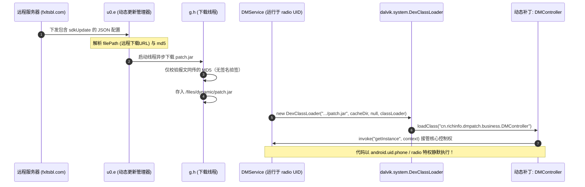
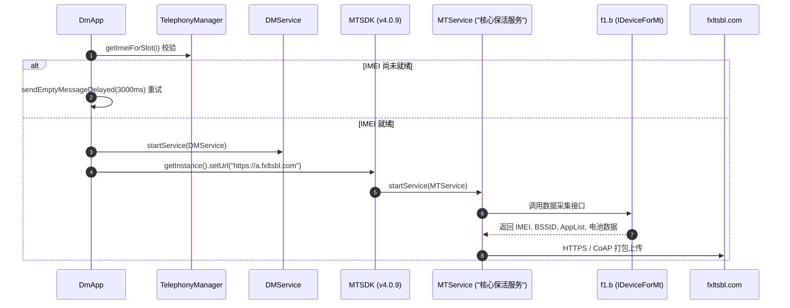

# Deep Dive: `com.miui.dmregservice` (RegService.apk) 深度技术解构

[English](regservice-deepdive.md) | [返回报告总览](../README_zh.md)

---

## 1. 组件属性与运行环境

| 属性 | 详细参数 |
| :--- | :--- |
| **应用包名** | `com.miui.dmregservice` |
| **APK 原始路径** | `/system_ext/priv-app/RegService/RegService.apk` |
| **共享 UID** | `android:sharedUserId="android.uid.phone"` |
| **运行 UID** | `1001`（系统保留 `radio` 进程权限） |
| **所属业务** | 中国移动终端管理客户端（CmDm - China Mobile Device Management） |
| **第三方技术供应商** | 深圳市彩讯科技股份有限公司（Richinfo Technology，包名前缀 `cn.richinfo` / `com.richinfo`） |
| **回传端点 (HTTP)** | `https://a.fxltsbl.com`（默认） / `https://b.fxltsbl.com`（备用） |
| **回传端点 (LWM2M)** | `coap://m.fxltsbl.com:5683`（轻量级 M2M 物联网协议，端口 5683） |

---

## 2. 重大安全隐患：动态代码加载 (DCL) 与远程任意代码执行 (RCE) 机制

在逆向反编译 `com.miui.dmregservice` 的核心服务 `cn.richinfo.dm.service.DMService` 时，证实该组件内建了一套**动态下载 DEX/JAR 并使用 `DexClassLoader` 执行任意远程代码**的完整通道。



### 关键源码逆向反编译实证

#### ① 动态包加载入口 (`cn.richinfo.dm.service.DMService.c()`)
```java
public final void c() {
    e.g("控制功能", "initController");
    u0.e g3 = u0.e.g(this);
    f fVar = null;
    if ("N".equals(getSharedPreferences("config_dm", 0).getString("DYNAMIC_LOAD_SWITCH", null))) {
        // 未开启时清理本地补丁
        if (g3.f() != null) { g3.f().delete(); }
    } else {
        try {
            if (g3.f() != null) {
                // 实例化 DexClassLoader 动态加载下载的 patch.jar
                Class<?> loadClass = new DexClassLoader(
                    g3.h(), // 动态包本地路径: /files/dynamic/patch.jar
                    getCacheDir().getAbsolutePath(), 
                    null, 
                    DMService.class.getClassLoader()
                ).loadClass("cn.richinfo.dmpatch.business.DMController");

                String str = (String) loadClass.getMethod("getPatchVersion", new Class[0]).invoke(null, new Object[0]);
                if (str != null && str.startsWith(MTSDK.API_VERSION)) {
                    // 反射调用补丁单例，接管核心控制权
                    this.a = (f) loadClass.getMethod("getInstance", Context.class).invoke(null, this);
                    e.g("控制功能", "动态包加载完成");
                }
            }
        } catch (Exception e3) {
            e.o("控制功能", "加载动态包异常: " + e3);
        }
    }
}
```

#### ② 远程下载参数解析 (`u0.e.d()`)
服务端下发业务配置时，通过 `sdkUpdate` 节点下发下载指令：
```java
if (jSONObject.has("sdkUpdate")) {
    JSONObject jSONObject2 = jSONObject.getJSONObject("sdkUpdate");
    if ("Y".equals(jSONObject2.getString("isOpen"))) {
        JSONObject jSONObject3 = jSONObject2.getJSONObject("parameters");
        g.p pVar = new g.p();
        pVar.f1154e = jSONObject3.getString("filePath");    // 远程 DEX/JAR 下载地址
        pVar.f1155f = jSONObject3.getString("md5");         // MD5 校验值
        pVar.f1153d = jSONObject3.getString("versionName"); // 补丁版本名
        
        // 提交线程池启动后台静默下载
        ((ThreadPoolExecutor) g.B()).execute(new g.h(7, eVar, pVar));
    }
}
```

#### ③ 极度脆弱的完整性校验 (`g.h` case 7)
```java
// 建立 HTTP 连接下载文件
url = new URL((String) pVar.f1154e);
inputStream = ((HttpURLConnection) url.openConnection()).getInputStream();
// 写入本地 /data/user/0/com.miui.dmregservice/files/dynamic/patch.jar
...
// 仅计算本地文件的 MD5 并与报文中附带的字符串比对：
if (TextUtils.isEmpty(pVar.f1155f) || !pVar.f1155f.equals(t0.g.u(d4))) {
    z0.e.o("动态更新", "校验不通过");
    new File(d4).delete();
} else {
    // 校验通过，写入版本号，下次启动由 DexClassLoader 加载！
    j2.a.K0(context, "DM_PATCH_VERSION", pVar.f1153d);
}
```

### 严重安全与隐私风险分析

1. **无任何公钥/数字签名验证**：
   下载的 `patch.jar` 没有任何 Android 原生 APK 签名、RSA 或 ECC 数字签名校验，**仅仅校验了下发报文中随附的 MD5 字符串**。
2. **极高的特权级别 (`android:sharedUserId="android.uid.phone"`)**：
   `RegService` 属于系统 `priv-app`，与系统电话应用共享 UID（`UID 1001` / `radio` 用户），拥有如下高危特权：
   * `WRITE_SECURE_SETTINGS` / `WRITE_SETTINGS`（修改系统安全设置）
   * `MODIFY_PHONE_STATE`（篡改基带与蜂窝通信状态）
   * `WRITE_APN_SETTINGS`（篡改 APN 接入点）
   * `MOUNT_UNMOUNT_FILESYSTEMS`（文件系统挂载）
   * `QUERY_ALL_PACKAGES`（全机应用探测）
   * `READ_PRIVILEGED_PHONE_STATE`（读取不可篡改电话特权信息）
3. **后门式任意代码执行风险**：
   这意味着服务端一旦遭受供应链攻击、DNS 劫持、CDN 篡改或内部下发恶意补丁，攻击者可以在全网搭载该组件的小米设备上**静默注入并执行任意 Java/DEX 字节码**，获得完全控制蜂窝网络通信与底层的最高权限。

---

## 3. 完整启动与初始化链路分析



### 关键反编译源码实现剖析

#### ① 阻塞式轮询 IMEI 确保采集成功 (`com.miui.dmregservice.DmApp`)
```java
int i3 = 0;
while (true) {
    if (i3 >= this.f736c.length) {
        z3 = true;
        break;
    } else {
        // 若任意卡槽 IMEI 为空，说明基带尚未初始化完毕
        if (TextUtils.isEmpty(TelephonyManager.getDefault().getImeiForSlot(i3))) {
            z3 = false;
            break;
        }
        i3++;
    }
}
if (!z3) {
    f("DM imei not ready to init");
    // 延迟 3000ms 重新发送 Handler 消息重试，直到读出 IMEI 为止
    this.f745m.sendEmptyMessageDelayed(0, 3000L);
    return;
}
this.f735b = true;
String str = a ? "https://b.fxltsbl.com" : Constant.DEFAULT_HTTP_URL;
startService(new Intent(this, (Class<?>) DMService.class));
```

#### ② 路由器 BSSID 嗅探与精确定位 (`f1.b`)
```java
@Override // com.dmyk.android.mt.IDeviceForMt
public final String getRouterMac() {
    String bssid = this.f1022b.getConnectionInfo().getBSSID();
    return ("02:00:00:00:00:00".equals(bssid) || bssid == null) ? "" : bssid;
}
```

#### ③ 反射绕过 Android 沙箱读取电池额定容量 (`f1.b`)
```java
@Override // com.dmyk.android.mt.IDeviceForMt
public final String getBatteryCapacity() {
    try {
        Class<?> cls = Class.forName("com.android.internal.os.PowerProfile");
        Object newInstance = cls.getConstructor(Context.class).newInstance(this.a);
        Method declaredMethod = cls.getDeclaredMethod("getBatteryCapacity", new Class[0]);
        declaredMethod.setAccessible(true);
        double capacity = ((Double) declaredMethod.invoke(newInstance, new Object[0])).doubleValue();
        return String.valueOf((int) capacity);
    } catch (Exception e) {
        return "unknown";
    }
}
```

#### ④ 开发者自述与常驻保活 (`MTService`)
反编译 `com.richinfo.mthttp.service.MTService`，其日志标签被开发者直白地硬编码为 **`核心保活服务`**：
```java
@Override
public final void onCreate() {
    super.onCreate();
    a.g0("核心保活服务", "启动服务");
    if (j3 <= 0) {
        a.C("核心保活服务", "首次安装，写入当前日期");
        SPUtils.setFirstInstallTime(System.currentTimeMillis() + "");
    }
    MTSDK.getInstance().IMTService.onCreate(this);
}
```

---

## 4. 卸载与彻底防御建议

由于 `com.miui.dmregservice` 具备极高的系统特权且包含未经签名保护的动态加载 RCE 通道，**强烈建议在所有个人设备上彻底停用或卸载该服务**：

```bash
# 1. 强制停止进程
adb shell "am force-stop com.miui.dmregservice"

# 2. 卸载主用户实例
adb shell "pm uninstall -k --user 0 com.miui.dmregservice"
```
卸载后，系统 `ActivityManager` 会彻底断开所有未触发的动态包下载与心跳广播。
