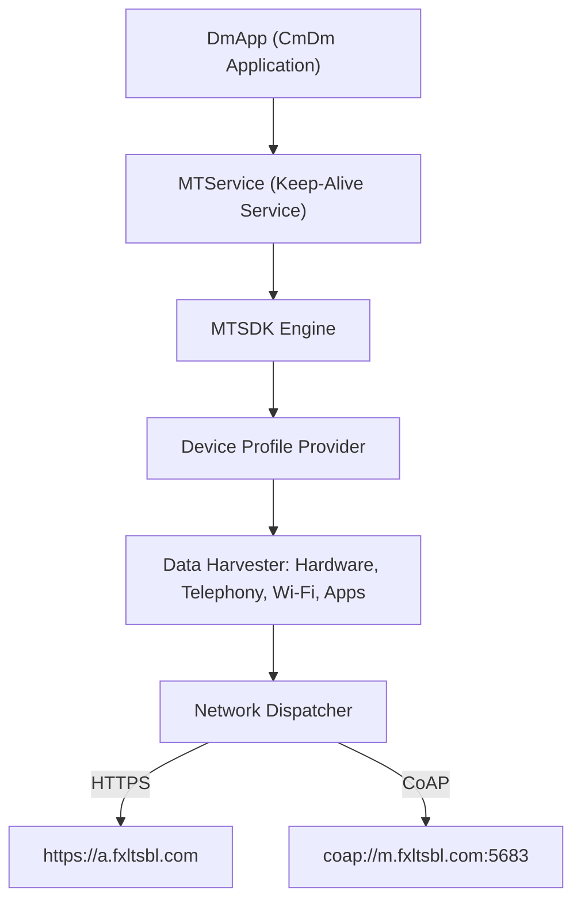

# Deep Dive: `com.miui.dmregservice` (RegService.apk)

## Overview

| Attribute | Details |
| :--- | :--- |
| **Package Name** | `com.miui.dmregservice` |
| **APK Path** | `/system_ext/priv-app/RegService/RegService.apk` |
| **Default UID** | `1001` (`radio`) |
| **Target Carrier** | China Mobile (中国移动 - CmDm) |
| **Third-Party Vendor** | Richinfo Technology (彩讯科技 - `cn.richinfo`) |
| **Primary Endpoints** | `https://a.fxltsbl.com`<br>`https://b.fxltsbl.com`<br>`coap://m.fxltsbl.com:5683` |
| **Protocols** | HTTPS POST, LWM2M over CoAP |

---

## 1. Architecture & Core Components

In HyperOS / MIUI, `com.miui.dmregservice` runs as a privileged system process under the `radio` UID. It embeds the **Richinfo MTSDK (v4.0.9)**, which establishes a persistent background keep-alive loop and periodic reporting pipeline.



### Component Analysis

* **Application Layer (`DmApp`)**:
  Initializes `MTSDK` and selects the active carrier reporting URL between primary (`https://a.fxltsbl.com`) and backup (`https://b.fxltsbl.com`).
* **Keep-Alive Daemon (`MTService`)**:
  A long-running background service that persists first-install timestamps and orchestrates periodic heartbeats using Android `JobScheduler` and dynamic alarms.
* **Device Interface (`IDeviceForMt`)**:
  Exposes system device data collection hooks for hardware specs, network states, and installed applications.

---

## 2. Telemetry Harvested

The telemetry collection routines systematically aggregate:

1. **Hardware & Device Identifiers**:
   * IMEI 1 and IMEI 2
   * Hardware Serial Number (`android.os.Build.getSerial()`)
   * Board ID, Device Model, Manufacturer Brand
   * Screen Resolution and Display Dimensions
   * Total System RAM and Internal Storage Capacity
2. **Wi-Fi & Bluetooth Profiling**:
   * Device Wi-Fi MAC Address
   * Connected Wi-Fi Router BSSID (enabling precise physical location triangulation)
   * Bluetooth MAC Address
3. **Telephony & Network Information**:
   * Active Network Type (5G, 4G, Wi-Fi)
   * Carrier Name and Network State
   * SIM Line 1 Phone Number
   * VoLTE Enabled/Disabled status
4. **App Inventory**:
   * Application Labels and Package Names
5. **Battery Diagnostics**:
   * Battery capacity queried via Java reflection into `com.android.internal.os.PowerProfile`.

---

## 3. Network & Runtime Evidence

### Lifetime Sessions via `dumpsys netstats`
Querying the system network stats showed that `com.miui.dmregservice` (UID 1001) opened **over 12,330 distinct network sessions** to the remote endpoints:
```text
Top openSession callers:
  {uid=1001,package=com.miui.dmregservice}=5992
  {uid=1001001,package=com.miui.dmregservice}=4761
  {uid=1101001,package=com.miui.dmregservice}=1578
```

### Uninstallation Impact
Once removed via ADB (`pm uninstall -k --user 0 com.miui.dmregservice`), the Android OS `ActivityManager` and `AlarmManager` immediately drop all queued wakeups:
```log
ActivityManager: Unable to start service Intent { act=... pkg=com.miui.dmregservice } U=0: not found
```
No further outgoing sessions are permitted by the OS scheduler for User 0.
