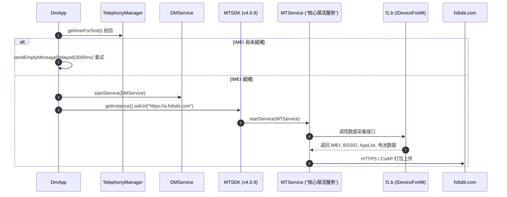

# Deep Dive: `com.miui.dmregservice` (RegService.apk) 深度技术解构

[English](regservice-deepdive.md) | [返回报告总览](../README_zh.md)

---

## 1. 组件属性与运行环境

| 属性 | 详细参数 |
| :--- | :--- |
| **应用包名** | `com.miui.dmregservice` |
| **APK 原始路径** | `/system_ext/priv-app/RegService/RegService.apk` |
| **运行 UID** | `1001`（系统保留 `radio` 进程权限） |
| **所属业务** | 中国移动终端管理客户端（CmDm - China Mobile Device Management） |
| **第三方技术供应商** | 深圳市彩讯科技股份有限公司（Richinfo Technology，包名前缀 `cn.richinfo` / `com.richinfo`） |
| **回传端点 (HTTP)** | `https://a.fxltsbl.com`（默认） / `https://b.fxltsbl.com`（备用） |
| **回传端点 (LWM2M)** | `coap://m.fxltsbl.com:5683`（轻量级 M2M 物联网协议，端口 5683） |

---

## 2. 完整启动与初始化链路分析



### 关键反编译源码实现剖析

#### ① 阻塞式轮询 IMEI 确保采集成功 (`com.miui.dmregservice.DmApp`)
在 `DmApp` 初始化方法中，程序并不立刻回传，而是循环轮询 SIM 卡槽的 IMEI：
```java
int i3 = 0;
while (true) {
    if (i3 >= this.f736c.length) {
        z3 = true;
        break;
    } else {
        // 若任意卡槽 IMEI 为空，说明基带尚未初始化完毕
        if (TextUtils.isEmpty(TelephonyManager.getDefault().getImeiForSlot(i3))) {
            z3 = false;
            break;
        }
        i3++;
    }
}
if (!z3) {
    f("DM imei not ready to init");
    // 延迟 3000ms 重新发送 Handler 消息重试，直到读出 IMEI 为止
    this.f745m.sendEmptyMessageDelayed(0, 3000L);
    return;
}
this.f735b = true;
String str = a ? "https://b.fxltsbl.com" : Constant.DEFAULT_HTTP_URL;
startService(new Intent(this, (Class<?>) DMService.class));
```
**分析**：这保证了即便在刚开机 SIM/Modem 尚未准备好的情况下，后台服务也会以 3 秒为周期死循环重试，确保设备指纹 100% 采集成功。

---

#### ② 路由器 BSSID 嗅探与精确定位 (`f1.b`)
在实现 `IDeviceForMt` 接口的 `f1.b` 类中，直接调用了底层 Wi-Fi 连接信息：
```java
@Override // com.dmyk.android.mt.IDeviceForMt
public final String getRouterMac() {
    String bssid = this.f1022b.getConnectionInfo().getBSSID();
    return ("02:00:00:00:00:00".equals(bssid) || bssid == null) ? "" : bssid;
}
```
**隐私危害**：Wi-Fi 路由器 BSSID 是全球公开的位置基准数据。即便用户彻底关闭了手机的 GPS 定位权限，只要上传了当前连接路由器的 BSSID，服务端调用开放的 BSSID 地理位置库（如 Wi-Fi 定位数据库），就能以小于 10 米的精度精确定位到用户所在的具体居室或写字楼。

---

#### ③ 反射绕过 Android 沙箱读取电池额定容量 (`f1.b`)
常规应用无法直接读取硬件电池的物理设计容量，该应用通过 Java 反射强行调用系统隐藏类：
```java
@Override // com.dmyk.android.mt.IDeviceForMt
public final String getBatteryCapacity() {
    try {
        Class<?> cls = Class.forName("com.android.internal.os.PowerProfile");
        Object newInstance = cls.getConstructor(Context.class).newInstance(this.a);
        Method declaredMethod = cls.getDeclaredMethod("getBatteryCapacity", new Class[0]);
        declaredMethod.setAccessible(true);
        double capacity = ((Double) declaredMethod.invoke(newInstance, new Object[0])).doubleValue();
        return String.valueOf((int) capacity);
    } catch (Exception e) {
        return "unknown";
    }
}
```
**分析**：利用私有隐藏 API `com.android.internal.os.PowerProfile` 提取物理电池容量，连同电池健康度用于辅助设备唯一性鉴伪与硬件生命周期追踪。

---

#### ④ 开发者自述与常驻保活 (`MTService`)
反编译 `com.richinfo.mthttp.service.MTService`，其日志标签被开发者直白地硬编码为 **`核心保活服务`**：
```java
@Override
public final void onCreate() {
    super.onCreate();
    a.g0("核心保活服务", "启动服务");
    if (j3 <= 0) {
        a.C("核心保活服务", "首次安装，写入当前日期");
        SPUtils.setFirstInstallTime(System.currentTimeMillis() + "");
    }
    MTSDK.getInstance().IMTService.onCreate(this);
}

@Override
public final void onDestroy() {
    a.C("核心保活服务", "控制服务被销毁");
    MTSDK.getInstance().IMTService.onDestroy();
    super.onDestroy();
}
```
配合 Android 的 `JobScheduler` 与动态 Alarm，在系统广播 `CONNECTIVITY_CHANGE`、`BOOT_COMPLETED` 时自动死灰复燃。
