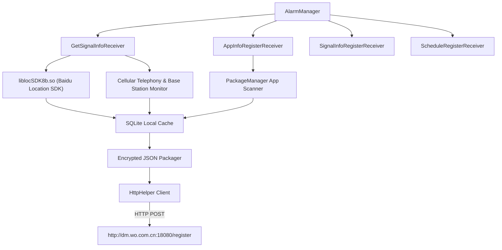

# Deep Dive: `com.mobiletools.systemhelper` (SystemHelper.apk)

## Overview

| Attribute | Details |
| :--- | :--- |
| **Package Name** | `com.mobiletools.systemhelper` |
| **APK Path** | `/product/pangu/system/priv-app/SystemHelper/SystemHelper.apk` |
| **Default UID** | `10099` |
| **Target Carrier** | China Unicom (中国联通 - 沃终端) |
| **Primary Endpoint** | `http://dm.wo.com.cn:18080/register` |
| **Payload Content-Type** | `application/encrypted-json` |
| **Embedded Libraries** | Baidu Location SDK (`liblocSDK8b.so`), OkHttp3 |

---

## 1. Architecture & Background Receivers

`SystemHelper` operates as a persistent cellular signal and device telemetry collector for China Unicom. It uses an alarm-based scheduling matrix to trigger periodic broadcast receivers.



### Component Analysis

* **Jittered 24-Hour Reporting Timer**:
  Configures the registration endpoint to `http://dm.wo.com.cn:18080/register` and schedules alarms using a 24-hour interval with a randomized initial offset up to 24 hours to scatter telemetry reports across the day.
* **Network Dispatcher**:
  Transmits the assembled device data as an `application/encrypted-json` HTTP POST request to China Unicom's terminal management server.
* **Signal & Location Receiver (`GetSignalInfoReceiver`)**:
  Wakes up periodically, loads the native Baidu Location engine (`liblocSDK8b.so`), and polls nearby cell towers, signal quality metrics (RSSI, RSRP, RSRQ), and geographic coordinates.

---

## 2. Telemetry Harvested

1. **Precise Geolocation**:
   * Uses Baidu Location SDK (`liblocSDK8b.so`) to acquire GPS coordinates, Wi-Fi location, and assisted cell tower fixes.
2. **Cellular Network Infrastructure**:
   * Base Station ID, LAC (Location Area Code), TAC (Tracking Area Code), Cell Identity (CI), MNC, MCC.
   * Signal strength metrics across 4G/5G bands.
3. **Hardware & Subscriber Identifiers**:
   * IMSI, ICCID, Device Serial Number, Storage filesystem capacity (`StatFs` on `/data`).
4. **Application Inventory**:
   * Scans and serializes package names, versions, and installation dates of all user-installed applications via `AppInfoRegisterReceiver`.

---

## 3. Runtime Observations & Mitigation

### Netstats Audit
In the device's lifetime connection records (`dumpsys netstats`), `com.mobiletools.systemhelper` accounted for **12,060 open sessions**:
```text
Top openSession callers:
  {uid=10099,package=com.mobiletools.systemhelper}=10131
  {uid=1010099,package=com.mobiletools.systemhelper}=1929
```

### Work Profile Persistence (User 10)
Even after removal from User 0, the app remained alive in the enterprise Work Profile (`User 10`, PID 31396) because ADB lacks permission to call `pm uninstall` across managed profile boundaries (`SecurityException: Shell does not have permission to access user 10`).

To completely neutralize the app in User 10:
```bash
# 1. Blacklist network background access
cmd netpolicy add restrict-background-blacklist 1010099

# 2. Revoke core AppOps permissions
cmd appops set --user 10 com.mobiletools.systemhelper RUN_IN_BACKGROUND ignore
cmd appops set --user 10 com.mobiletools.systemhelper RUN_ANY_IN_BACKGROUND ignore
cmd appops set --user 10 com.mobiletools.systemhelper FINE_LOCATION ignore
cmd appops set --user 10 com.mobiletools.systemhelper COARSE_LOCATION ignore
cmd appops set --user 10 com.mobiletools.systemhelper READ_PHONE_STATE ignore
cmd appops set --user 10 com.mobiletools.systemhelper WIFI_SCAN ignore
cmd appops set --user 10 com.mobiletools.systemhelper BLUETOOTH_CONNECT ignore
```
