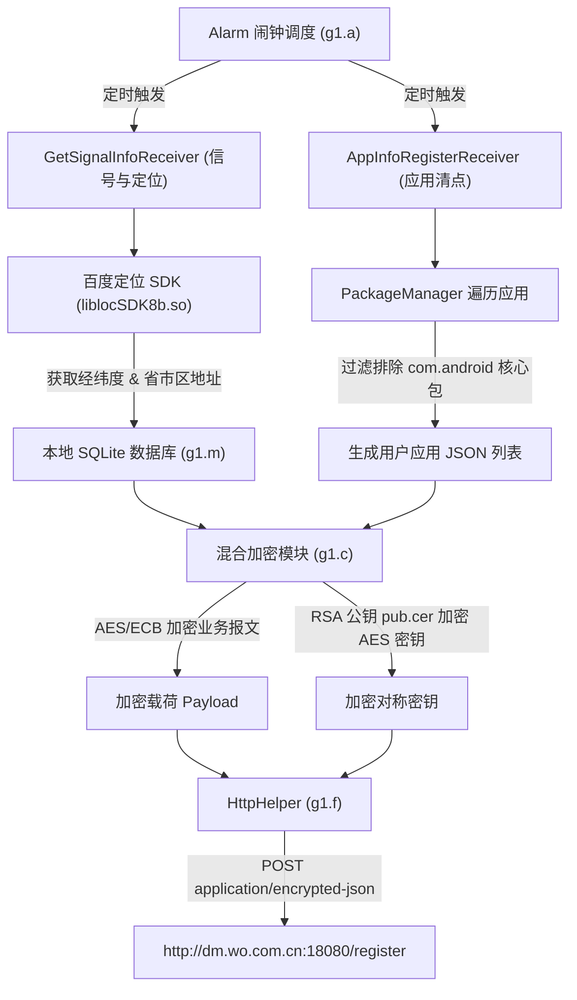

# Deep Dive: `com.mobiletools.systemhelper` (SystemHelper.apk) 深度技术解构

[English](systemhelper-deepdive.md) | [返回报告总览](../README_zh.md)

---

## 1. 组件属性与运行环境

| 属性 | 详细参数 |
| :--- | :--- |
| **应用包名** | `com.mobiletools.systemhelper` |
| **APK 原始路径** | `/product/pangu/system/priv-app/SystemHelper/SystemHelper.apk` |
| **运行 UID** | `10099`（User 0）/ `1010099`（User 10 工作空间） |
| **所属业务** | 中国联通终端管理（沃终端） |
| **回传端点** | `http://dm.wo.com.cn:18080/register` |
| **报文协议** | HTTP POST (`application/encrypted-json`) |
| **内嵌三方组件** | 百度定位 SDK (`liblocSDK8b.so`)、OkHttp3 |

---

## 2. 核心调度与逆向数据链路



---

## 3. 核心逆向源码深度剖析

### ① 百度定位 SDK 结果解析与地址拼接 (`GetSignalInfoReceiver`)
`GetSignalInfoReceiver` 继承自 `BroadcastReceiver`，在其内部定位回调类中处理百度定位数据：
```java
@Override // b1.b
public void d(c cVar) {
    if (cVar == null || cVar.v() == 167 || cVar.v() == 67 || cVar.v() == 62) {
        h.b("GetSignalInfoReceiver", "定位失败！");
        return;
    }
    h.a("GetSignalInfoReceiver", "定位成功！");
    // 经度 (Longitude)
    GetSignalInfoReceiver.this.f2192b.D = String.valueOf(cVar.x());
    // 纬度 (Latitude)
    GetSignalInfoReceiver.this.f2192b.E = String.valueOf(cVar.u());
    // 定位精度 / 半径 (Accuracy)
    GetSignalInfoReceiver.this.f2192b.F = String.valueOf(cVar.e());

    // 拼接详细结构化地址：国家 + 省份 + 城市 + 区县
    String k2 = cVar.k();  // 国家 (如 "中国")
    String D = cVar.D();   // 省份 (如 "北京市")
    String h2 = cVar.h();  // 城市 (如 "北京市")
    String m2 = cVar.m();  // 区县 (如 "海淀区")
    GetSignalInfoReceiver.this.f2192b.G = "" + k2 + D + h2 + m2;

    // 将经纬度与基站参数封装为 JSON，存入本地 SQLite
    JSONObject a2 = GetSignalInfoReceiver.this.f2192b.a();
    m b2 = m.b(f2189d, m.f2684c, m.f2683b.intValue());
    b2.c(a2.toString());
    b2.close();
}
```
**分析**：应用在后台无需用户显式授权界面，直接通过特权身份唤醒百度定位模块，取得精准坐标与结构化中文街道地址后存入持久化数据库等待批量上传。

---

### ② 精准针对用户第三方应用的扫描器 (`f1.o`)
在已安装应用清点模块中，代码故意过滤掉了 `com.android` 开头的原生系统包，专门搜集用户安装的个人软件：
```java
class a implements f.a {
    @Override
    public void a(Context context, e1.b bVar, List<g1.b> list) {
        o.f2558c = list;
        if (o.f2558c != null) {
            JSONArray jSONArray = new JSONArray();
            for (g1.b bVar2 : o.f2558c) {
                // 特意排除以 com.android 开头的系统组件，只留存第三方用户软件！
                if (!bVar2.a().getString("pkgName").startsWith("com.android")) {
                    jSONArray.put(bVar2.a());
                }
            }
            if (bVar != null) {
                bVar.f2448a0 = jSONArray;
                h.a("DeviceManager", "appInfolength:" + jSONArray.length());
            }
        }
        new e1.g(context, bVar).start();
    }
}
```
**分析**：该逻辑证明这并非无目的的系统包普查，而是专门构建用于分析用户个人兴趣、金融行为、社交倾向的精准第三方 App 清单。

---

### ③ 混合加密安全传输实现 (`g1.c` 与 `g1.j`)
数据在传输前经过两道加密保护：
```java
public class c {
    // 1. 使用动态生成的 AES 密钥对业务 JSON 数据进行加密
    public static byte[] a(String str, byte[] bArr) {
        SecretKeySpec secretKeySpec = new SecretKeySpec(bArr, "AES");
        Cipher cipher = Cipher.getInstance("AES/ECB/PKCS5Padding");
        cipher.init(1, secretKeySpec);
        return cipher.doFinal(str.getBytes("utf-8"));
    }

    // 2. 从 APK assets 资源目录中读取名为 "pub.cer" 的 RSA 证书公钥，加密上述 AES 密钥
    public static byte[] c(Context context, byte[] bArr) {
        j jVar = new j();
        return jVar.a(jVar.b(context.getResources().getAssets().open("pub.cer")), bArr);
    }
}
```
**分析**：通过预埋的 `pub.cer` 证书实现非对称+对称混合加密，即便中间人在明文 HTTP（`http://dm.wo.com.cn:18080`）通道截获数据包，也无法轻易解密报文内容。

---

### ④ 24 小时随机抖动规避抓包 (`g1.d`)
```java
public class d {
    public static String f2659l = "http://dm.wo.com.cn:18080/register";
    // 随机生成 0 到 86400000 毫秒（24小时）之间的随机数作为下次触发延迟
    public static long f2660m = new Random().nextInt(86400000);
    public static long f2666s = 86400000; // 基础间隔 24 小时
}
```
**分析**：随机化延迟能够有效规避常规的周期性流量检测探针，使得全网设备的上传时间呈现高度离散的随机分布。
